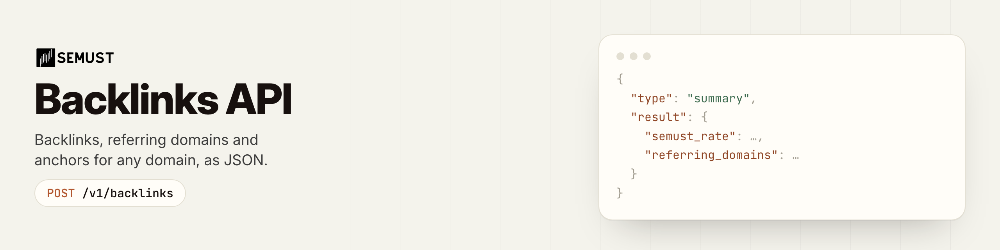
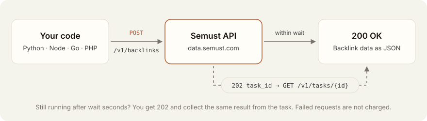
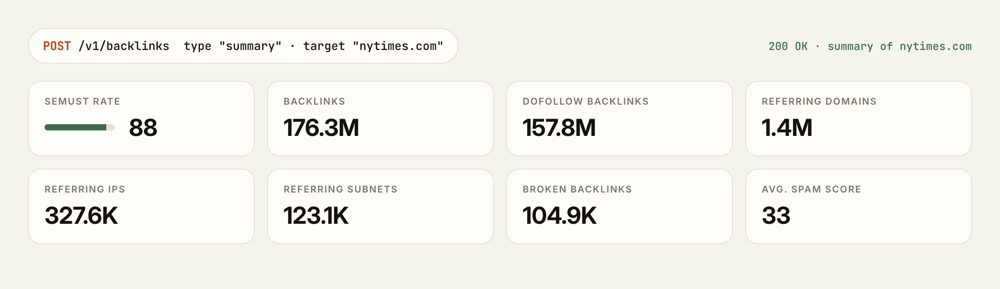

# Backlinks API

[](https://semust.com/en/api-platform/backlinks-api?utm_source=github&utm_medium=referral&utm_campaign=backlinks-api&utm_content=banner)

[](https://app.semust.com/api/access?utm_source=github&utm_medium=referral&utm_campaign=backlinks-api&utm_content=badge)
[](https://semust.com/en/docs/api/backlinks?utm_source=github&utm_medium=referral&utm_campaign=backlinks-api&utm_content=badge)
[](https://github.com/Semust-com/semust-mcp)
[](LICENSE)

The [Semust Backlinks API](https://semust.com/en/api-platform/backlinks-api?utm_source=github&utm_medium=referral&utm_campaign=backlinks-api&utm_content=intro) returns the backlink profile of any domain, subdomain or page as clean, structured JSON: total and dofollow backlinks, referring domains, anchor texts, authority and spam scores, link history and backlink competitors. One endpoint serves eight reports, from a one-call summary to every individual link with its anchor, position and first-seen date. No crawling, link databases or HTML parsing on your side.

It is built for SEO teams, agencies and developers who need **backlink audits, link building prospecting, competitor link analysis and link monitoring inside their own tools**. The API is part of the [Semust](https://semust.com/en?utm_source=github&utm_medium=referral&utm_campaign=backlinks-api&utm_content=intro) SEO platform.

- [How it works](#how-it-works)
- [Request parameters](#request-parameters)
- [Output sample](#output-sample)
- [JSON output structure](#json-output-structure)
- [Errors](#errors)
- [Pricing](#pricing)
- [Use cases](#use-cases)
- [FAQ](#faq)

## How it works

<picture>
  <source media="(prefers-color-scheme: dark)" srcset="images/how-it-works-dark.svg">
  
</picture>

### 1. Get your API credentials

Create an API user on the [Semust API access page](https://app.semust.com/api/access?utm_source=github&utm_medium=referral&utm_campaign=backlinks-api&utm_content=credentials). You get a username and a password. Every request sends them as two headers:

| Header | Value |
| --- | --- |
| `SEMUST-API-USER` | Your API username |
| `SEMUST-API-PASSWORD` | Your API password |

The examples in this repository read them from environment variables, so they never end up in your code:

```bash
export SEMUST_API_USER="your_username"
export SEMUST_API_PASSWORD="your_password"
```

> [!TIP]
> There is no subscription. You top up a prepaid balance and pay only for successful requests; failed requests are refunded automatically. Prices are on the [Backlinks API page](https://semust.com/en/api-platform/backlinks-api?utm_source=github&utm_medium=referral&utm_campaign=backlinks-api&utm_content=pricing).

### 2. Send a request

```python
import os, time, requests

HEADERS = {
    "SEMUST-API-USER": os.environ["SEMUST_API_USER"],
    "SEMUST-API-PASSWORD": os.environ["SEMUST_API_PASSWORD"],
}

resp = requests.post(
    "https://data.semust.com/v1/backlinks",
    params={"wait": 60},
    headers=HEADERS,
    json={"type": "summary", "target": "nytimes.com"},
    timeout=90,
)
while resp.status_code == 202:  # still running: poll the task
    time.sleep(int(resp.headers.get("Retry-After", 5)))
    resp = requests.get(resp.json()["poll_url"], headers=HEADERS, timeout=30)

summary = resp.json()["result"]
print(summary["semust_rate"], summary["total_backlinks"], summary["referring_domains"])
```

### 3. Run the examples

| Language | File | Run |
| --- | --- | --- |
| Python | [`examples/python/backlinks.py`](examples/python/backlinks.py) | `python backlinks.py nytimes.com` |
| Python, backlinks to CSV with cursor paging | [`examples/python/backlinks_export.py`](examples/python/backlinks_export.py) | `python backlinks_export.py example.com --one-per-domain --dofollow` |
| Node.js 18+ | [`examples/node/backlinks.mjs`](examples/node/backlinks.mjs) | `node backlinks.mjs nytimes.com` |
| Go | [`examples/go/main.go`](examples/go/main.go) | `go run . nytimes.com` |
| PHP | [`examples/php/backlinks.php`](examples/php/backlinks.php) | `php backlinks.php nytimes.com` |
| cURL | [`examples/curl/backlinks.sh`](examples/curl/backlinks.sh) | `./backlinks.sh` |

## Request parameters

`POST https://data.semust.com/v1/backlinks` with a JSON body. `type` picks the report:

| `type` | Returns | Parameters (besides `target`, `scope`) |
| --- | --- | --- |
| `summary` (default) | One metric block: totals, referring domains, authority, spam score and breakdowns | `status`, `include_subdomains`, `exclude_internal`, `include_redirects`, `breakdown_limit` |
| `backlinks` | The individual backlinks | `status`, `include_subdomains`, `exclude_internal`, `include_redirects`, `limit`, `offset`, `cursor`, `group_by`, `filters`, `order_by`, `breakdown_limit` |
| `referring_domains` | Domains linking to the target, aggregated | `status`, `include_subdomains`, `exclude_internal`, `include_redirects`, `limit`, `offset`, `filters`, `order_by`, `breakdown_limit` |
| `anchors` | Anchor texts, aggregated | same as `referring_domains` |
| `pages` | The target's own pages, ranked by the backlinks they receive | same as `referring_domains` |
| `competitors` | Domains whose backlink profile overlaps the target's | `include_subdomains`, `exclude_internal`, `limit`, `offset`, `filters`, `order_by` |
| `history` | The summary metrics month by month | `date_from`, `date_to`, `include_breakdowns`, `breakdown_limit` |
| `timeseries` | New and lost backlinks and referring domains per period | `include_subdomains`, `date_from`, `date_to`, `granularity` |

A parameter that does not apply to the chosen `type` is rejected with `INVALID_REQUEST` instead of being ignored.

| Parameter | Type | Default | Description |
| --- | --- | --- | --- |
| `target` **(required)** | string | – | Domain, subdomain or page URL. Scheme and `www.` are removed for domain lookups. |
| `type` | string | `summary` | The report, from the table above. |
| `scope` | string | `domain` | `domain` includes every subdomain, `host` the exact host only, `url` one page (the target must then start with `http://` or `https://`). |
| `status` | string | `live` | `live` for links still in place, `lost` for links that disappeared, `all` for both. |
| `include_subdomains` | boolean | `true` for `scope: domain` | Count links that point at subdomains of the target. |
| `exclude_internal` | boolean | `true` | Leave out links from the target's own site. |
| `include_redirects` | boolean | `true` | Count links that reach the target through a redirect or canonical. |
| `limit` | integer | `100` | Rows to return, 1–1000. |
| `offset` | integer | `0` | Rows to skip, 0–20,000. Use `cursor` to go deeper. |
| `cursor` | string | – | `type: backlinks` only: the `next_cursor` of the previous page. Cannot be combined with `offset`; expires after 30 minutes. |
| `group_by` | string | `none` | `type: backlinks` only: `domain` returns one backlink per referring domain, `anchor` one per anchor text. |
| `filters` | array | – | Conditions on the response fields, e.g. `[["is_dofollow", "=", true], "and", ["source_domain_rate", ">=", 40]]`. See below. |
| `order_by` | string[] | – | Up to 3 rules, each `"field,asc"` or `"field,desc"`, e.g. `["source_domain_rate,desc"]`. |
| `date_from`, `date_to` | string | last 12 months | `history` and `timeseries`: `YYYY-MM-DD`. Data starts on 2019-02-01. |
| `granularity` | string | `month` | `timeseries`: `day`, `week`, `month` or `year`. |
| `include_breakdowns` | boolean | `false` | `history`: add the `links_by_*` maps to every month. |
| `breakdown_limit` | integer | `25` | Entries kept in each `links_by_*` map, 1–1000, largest first. |

**Filters.** A condition is `[field, operator, value]`; join conditions with `"and"` or `"or"`, and nest arrays to mix both. Strings take `=`, `<>`, `in`, `not_in`, `like`, `not_like`, `ilike`, `not_ilike`, `match`, `not_match`, `regex` and `not_regex` (`%` is the `like` wildcard); numbers take `<`, `<=`, `>`, `>=`, `=`, `<>`, `in` and `not_in`; dates (RFC 3339) take `<`, `<=`, `>`, `>=` and `=`; enums `=`, `<>`, `in` and `not_in`; booleans `=` and `<>`. Up to 8 conditions and 3 levels of nesting. `GET https://data.semust.com/v1/backlinks/filters?type=backlinks` lists every filterable and sortable field per report with its operators, free of charge.

| Query parameter | Default | Description |
| --- | --- | --- |
| `wait` | `60` | Seconds to hold the connection before answering `202`, 0–80. `0` answers `202` at once (fire and collect). |

| Header | Description |
| --- | --- |
| `Idempotency-Key` | Optional, up to 128 characters. Repeating a request with the same key returns the same task and is charged once. The body field `idempotency_key` does the same. |

## Output sample



The complete response for `{"type": "summary", "target": "nytimes.com"}`, also saved as [`output-backlinks-api.json`](output-backlinks-api.json). Each `links_by_*` map holds the 25 largest entries, the default `breakdown_limit`.

```json
{
  "success": true,
  "cached": false,
  "cost": 0.02644,
  "type": "summary",
  "target": "nytimes.com",
  "scope": "domain",
  "total": 1,
  "count": 1,
  "next_cursor": null,
  "result": {
    "target": "nytimes.com",
    "first_seen": "2019-01-15T22:55:45Z",
    "lost_at": null,
    "is_live": true,
    "semust_rate": 88,
    "total_backlinks": 176306916,
    "dofollow_backlinks": 157764334,
    "nofollow_backlinks": 18542582,
    "broken_backlinks": 104932,
    "broken_pages": 22284,
    "avg_spam_score": 33,
    "referring_domains": 1412693,
    "referring_domains_dofollow": 1322544,
    "referring_domains_nofollow": 90149,
    "referring_root_domains": 1257619,
    "referring_root_domains_nofollow": 76762,
    "referring_ips": 327571,
    "referring_subnets": 123119,
    "referring_pages": 160754802,
    "referring_pages_nofollow": 18565482,
    "text_links_count": 155244403,
    "image_links_count": 5132811,
    "redirect_links_count": 277235,
    "internal_links_count": 616339,
    "outgoing_links_count": 99036,
    "links_by_tld": {
      "ai": 373816,
      "ba": 327506,
      "blogspot.com": 23923556,
      "ca": 368952,
      "co": 336211
    },
    "links_by_type": {
      "alternate": 3461,
      "canonical": 96892,
      "image": 5132811,
      "redirect": 277235,
      "text": 155244403
    },
    "links_by_attribute": {
      "alternate": 5818,
      "author": 43210,
      "bookmark": 319491,
      "canonical": 13,
      "contents": 5
    },
    "links_by_position": {
      "content": 141876990,
      "footer": 1685408,
      "header": 405115,
      "nav": 2916795,
      "sidebar": 13870494
    },
    "links_by_country": {
      "AI": 376645,
      "AU": 1122860,
      "BA": 327709,
      "BR": 1741886,
      "CA": 513642
    },
    "links_by_source_type": {
      "blog": 54547348,
      "business": 25591711,
      "ecommerce": 785572,
      "forum": 150996,
      "news": 11521403,
      "other": 113425414,
      "wiki": 1594936
    },
    "target_ip": "151.101.1.164",
    "target_country": "US",
    "target_cms": null,
    "target_server": "envoy",
    "target_spam_score": 1
  }
}
```

## JSON output structure

**Envelope** (every report)

| Field | Type | Description |
| --- | --- | --- |
| `success` | boolean | `true` for a successful request. |
| `cached` | boolean | `true` when the answer was served from cache, at the reduced rate. |
| `cost` | number | What this request cost, in USD. |
| `type`, `target`, `scope` | string | The report, the normalized target and the scope applied. |
| `total` | integer | Approximate number of matching rows. |
| `count` | integer | Rows in this response. This is what you are billed on. |
| `limit`, `offset` | integer | The paging applied, on row reports. |
| `next_cursor` | string | `type: backlinks`: pass it as `cursor` for the next page. `null` when there are no more rows. |
| `date_from`, `date_to`, `granularity` | string | `history` and `timeseries`: the range applied. |
| `result` | object | `summary`: the metric block below. |
| `results` | array | Every other report: the rows. |

**Summary** (`result`; each `history` row has the same metrics plus `date`, `new_backlinks`, `lost_backlinks`, `new_referring_domains`, `lost_referring_domains`)

| Field | Type | Description |
| --- | --- | --- |
| `target` | string | The target. |
| `semust_rate` | number | Authority of the target, 0–100. |
| `first_seen`, `lost_at` | string | When the target was first seen, and when it was lost (`null` while live). ISO 8601 UTC. |
| `is_live` | boolean | `true` while the target is live. |
| `total_backlinks`, `dofollow_backlinks`, `nofollow_backlinks` | integer | Backlink counts. |
| `broken_backlinks`, `broken_pages` | integer | Backlinks to broken pages, and target pages answering 4xx or 5xx. |
| `avg_spam_score` | integer | Average spam score across the backlinks, 0–100. |
| `referring_domains` | integer | Unique domains linking to the target. |
| `referring_domains_dofollow` | integer | Domains linking **only** with dofollow links. |
| `referring_domains_nofollow` | integer | Domains with at least one nofollow link. |
| `referring_root_domains`, `referring_root_domains_nofollow` | integer | Unique root domains. |
| `referring_ips`, `referring_subnets` | integer | Unique IP addresses and subnets of the linking sites. |
| `referring_pages`, `referring_pages_nofollow` | integer | Unique pages linking to the target. |
| `text_links_count`, `image_links_count`, `redirect_links_count` | integer | Backlinks by kind. |
| `internal_links_count`, `outgoing_links_count` | integer | Links inside the target, and links from the target to other sites. |
| `links_by_tld`, `links_by_type`, `links_by_attribute`, `links_by_position`, `links_by_country`, `links_by_source_type` | object | Backlink counts by TLD, link type, `rel` attribute, position on the page, country and kind of site. |
| `target_ip`, `target_country`, `target_cms`, `target_server` | string | Hosting details of the target. |
| `target_spam_score` | integer | Spam score of the target, 0–100. |

**Backlink** (`type: backlinks`)

| Field | Type | Description |
| --- | --- | --- |
| `source_url`, `source_domain`, `source_tld` | string | The linking page and its domain. |
| `target_url`, `target_domain` | string | The page that is linked to. |
| `anchor_text`, `anchor_type` | string | The clickable text, and its kind: `exact`, `branded`, `naked_url`, `generic`, `partial`, `image`, `empty` or `other`. |
| `image_url`, `image_alt`, `context_before`, `context_after` | string | Image links and the text around the anchor. |
| `link_type`, `link_position` | string | `text`, `image`, `redirect`, `canonical`, …; and `content`, `nav`, `header`, `footer` or `sidebar`. |
| `is_dofollow`, `is_ugc`, `is_sponsored`, `rel_attributes` | | Link attributes. |
| `is_new`, `is_live`, `is_broken`, `first_seen`, `last_seen` | | Link lifecycle. |
| `link_rate`, `source_page_rate`, `source_domain_rate` | number | Authority of the link, the linking page and the linking domain, 0–100. |
| `source_spam_score`, `target_spam_score` | integer | Spam scores, 0–100. |
| `source_type`, `source_country`, `source_language`, `source_page_title` | string | What kind of site links, from where and in which language. |
| `via_redirect`, `identical_links_count`, `target_status_code`, `target_redirect_url` | | Redirects, duplicates and the linked page's status. |

**Other reports**: `referring_domains` rows have `source_domain`, `semust_rate`, `total_links`, `dofollow_links`, `nofollow_links`, `first_seen`, `last_seen` and the `links_by_*` maps. `anchors` rows have `anchor_text`, `anchor_type`, `backlinks_count`, `referring_domains` and `link_rate`. `pages` rows have `page_url`, `page_title`, `status_code`, `backlinks_count`, `referring_domains` and `page_rate`. `competitors` rows have `competitor_domain`, `semust_rate` and `shared_backlinks`. `timeseries` rows have `date`, `new_backlinks`, `lost_backlinks`, `net_backlinks` and the same for referring domains. The [Backlinks API documentation](https://semust.com/en/docs/api/backlinks?utm_source=github&utm_medium=referral&utm_campaign=backlinks-api&utm_content=fields) lists every field.

## Long-running requests (202 and polling)

Most requests finish in a few seconds and return `200` with the result. If a request is still running after `wait` seconds (60 by default, maximum 80), the API returns `202 Accepted` with a `task_id` instead. Nothing is lost and you are not charged twice:

1. Read `task_id` from the body (also in the `X-Task-Id` header).
2. Wait `Retry-After` seconds.
3. Call `GET https://data.semust.com/v1/tasks/{task_id}` with the same headers until the status is no longer `202`. The final answer is exactly what the original request would have returned.

Every example in [`examples/`](examples) already handles this. Results stay available for 72 hours, and fetching them again is free. Set your HTTP client's read timeout above `wait` (for example `wait + 30` seconds). Send an `Idempotency-Key` header to retry a request safely without paying twice. Details: [Tasks & long-running requests](https://semust.com/en/docs/api/tasks?utm_source=github&utm_medium=referral&utm_campaign=backlinks-api&utm_content=tasks).

## Errors

Errors return JSON with a readable `error`, a stable `code` and, on server-side failures, a `request_id` to quote to support. Failed requests are not charged.

| HTTP | `code` | Meaning |
| --- | --- | --- |
| 400 | `INVALID_REQUEST` | The body is malformed, a parameter does not apply to this `type`, or a value is out of range. |
| 400 | `TARGET_REQUIRED`, `INVALID_TARGET` | `target` is missing, or is not a valid domain or URL for the `scope`. |
| 400 | `INVALID_TYPE` | Unknown `type`. |
| 400 | `INVALID_FILTER`, `INVALID_ORDER_BY` | Unknown field, wrong operator for the field, too many conditions or sort rules. |
| 400 | `INVALID_DATE_RANGE` | `date_from` is after `date_to`, or a date is not `YYYY-MM-DD`. |
| 400 | `INVALID_CURSOR` | The cursor is unknown or expired, combined with `offset`, or sent with a `type` other than `backlinks`. |
| 401 | `MISSING_CREDENTIALS`, `INVALID_CREDENTIALS`, `CREDENTIALS_EXPIRED` | Check the two auth headers. |
| 402 | `INSUFFICIENT_CREDITS` | Top up your balance. |
| 403 | `IP_NOT_WHITELISTED`, `SERVICE_NOT_ENABLED` | Your API user only accepts listed IP addresses, or is not allowed to use this service. |
| 413 | `REQUEST_TOO_LARGE` | The body is over 64 KB. |
| 429 | `RATE_LIMIT_EXCEEDED` | Slow down; the default limit is 60 requests per minute. |
| 503 | `REQUEST_FAILED`, `TIMEOUT`, `SERVICE_UNAVAILABLE` | Temporary failure. Retry with the same `Idempotency-Key`. |

## Pricing

**$0.0264 per request + $0.0396 per 1,000 rows returned.** The summary above is one row and cost $0.02644; 100 backlinks cost $0.03036 and a full page of 1,000 costs $0.066. `history` and `timeseries` bill one row per period in the date range. A request that matches nothing still costs the request fee. Repeating an identical request within the cache window (24 hours, 7 days for `history`) costs a flat $0.005 and returns `"cached": true`. Failed requests are refunded automatically. Current prices are on the [Backlinks API page](https://semust.com/en/api-platform/backlinks-api?utm_source=github&utm_medium=referral&utm_campaign=backlinks-api&utm_content=pricing).

## Use cases

1. **Backlink audits.** Pull every live backlink with its anchor, authority and spam score, and find toxic, broken or lost links. Export them with [`backlinks_export.py`](examples/python/backlinks_export.py).
2. **Link building prospecting.** List the referring domains of competing sites and filter for strong, dofollow domains that do not link to you yet.
3. **Competitor link analysis.** Compare authority, referring domains and anchor profiles, and use `competitors` to find sites with overlapping backlinks.
4. **Link monitoring.** Track new and lost backlinks and referring domains over time with `timeseries` and `history`, and alert when a valuable link disappears.
5. **SEO dashboards and AI agents.** Add authority and backlink counts to client reports, lead scoring or an agent that evaluates websites.

## Why Semust

- **Pay as you go.** No monthly plan or minimum commitment for the API. Top up once, pay per successful request, and get failed requests refunded automatically.
- **One account, every SEO dataset.** SERP, keyword data, backlinks, domain research, YouTube, Google Trends, Lighthouse and Google Business data use the same credentials, the same error format and the same task system.
- **Any country, any language.** Localised results for every Google market, including strong coverage of Türkiye and Turkish-language queries.
- **Built for AI workflows.** Plug the same data into Claude, Cursor or ChatGPT with the open-source [Semust MCP server](https://github.com/Semust-com/semust-mcp).

## FAQ

### What is Semust Rate?

`semust_rate` is Semust's 0–100 authority score for a domain or page, derived from the links pointing to it. Use it to compare sites and to rank link prospects; the same scale appears as `source_domain_rate` and `source_page_rate` on every backlink.

### How do I get every backlink of a large site?

Request `type: backlinks` with `limit: 1000` and pass the `next_cursor` of each response as `cursor` on the next request until it is `null`. `offset` alone stops at 20,000 rows; the cursor has no such limit. [`backlinks_export.py`](examples/python/backlinks_export.py) does exactly this.

### How do I list referring domains instead of individual links?

Use `type: referring_domains` for one aggregated row per domain, or `type: backlinks` with `group_by: domain` to get one example backlink per referring domain with cursor paging.

### Can I check a single page instead of a whole domain?

Yes. Send the full URL as `target` with `"scope": "url"`. `"scope": "host"` limits the report to one subdomain.

### Why is `referring_domains_dofollow` lower than I expect?

It counts domains that link **only** with dofollow links. A domain with both dofollow and nofollow links is counted in `referring_domains_nofollow`.

### Can I use it from Claude, ChatGPT or Cursor?

Yes. The [Semust MCP server](https://github.com/Semust-com/semust-mcp) connects your Semust account to AI assistants, and the [SEO MCP](https://semust.com/en/features/mcp/seo-mcp?utm_source=github&utm_medium=referral&utm_campaign=backlinks-api&utm_content=mcp) adds your Search Console, rank tracking and competitor data next to the backlinks you collect here.

## Learn more

- [Backlinks API documentation](https://semust.com/en/docs/api/backlinks?utm_source=github&utm_medium=referral&utm_campaign=backlinks-api&utm_content=learn_more) · [Turkish documentation](https://semust.com/docs/api/backlinks?utm_source=github&utm_medium=referral&utm_campaign=backlinks-api&utm_content=learn_more)
- [What are backlinks?](https://semust.com/en/blog/what-are-backlinks?utm_source=github&utm_medium=referral&utm_campaign=backlinks-api&utm_content=learn_more) · [What is a backlink? (Turkish)](https://semust.com/blog/backlink-nedir?utm_source=github&utm_medium=referral&utm_campaign=backlinks-api&utm_content=learn_more)
- [Best backlink tools (Turkish)](https://semust.com/blog/en-iyi-backlink-araclari?utm_source=github&utm_medium=referral&utm_campaign=backlinks-api&utm_content=learn_more)
- [Guest posting guide](https://semust.com/en/blog/guest-posting?utm_source=github&utm_medium=referral&utm_campaign=backlinks-api&utm_content=learn_more)
- [Free hacklink checker](https://semust.com/en/free-seo-tools/hacklink-checker?utm_source=github&utm_medium=referral&utm_campaign=backlinks-api&utm_content=learn_more) · [Free link extractor](https://semust.com/en/free-seo-tools/link-extractor?utm_source=github&utm_medium=referral&utm_campaign=backlinks-api&utm_content=learn_more)

## Related repositories

**SEO data APIs**

| Repository | What it does | Product page |
| --- | --- | --- |
| [google-serp-scraper](https://github.com/Semust-com/google-serp-scraper) | Organic results, People Also Ask, AI Overviews, ads and more as JSON | [Google SERP API](https://semust.com/en/api-platform/serp-api?utm_source=github&utm_medium=referral&utm_campaign=backlinks-api&utm_content=related) |
| [google-images-scraper](https://github.com/Semust-com/google-images-scraper) | Google Images results with titles, source pages and image URLs | [Google Images API](https://semust.com/en/api-platform/google-images-api?utm_source=github&utm_medium=referral&utm_campaign=backlinks-api&utm_content=related) |
| [youtube-scraper](https://github.com/Semust-com/youtube-scraper) | YouTube search, video details, transcripts and comments | [YouTube API](https://semust.com/en/api-platform/youtube-api?utm_source=github&utm_medium=referral&utm_campaign=backlinks-api&utm_content=related) |
| [google-trends-scraper](https://github.com/Semust-com/google-trends-scraper) | Interest over time, regions, related queries and demographics | [Google Trends API](https://semust.com/en/api-platform/trends-api?utm_source=github&utm_medium=referral&utm_campaign=backlinks-api&utm_content=related) |
| [google-business-scraper](https://github.com/Semust-com/google-business-scraper) | Google Business profiles, local search and reviews | [Google Business Data API](https://semust.com/en/api-platform/business-data-api?utm_source=github&utm_medium=referral&utm_campaign=backlinks-api&utm_content=related) |
| [keyword-research-api](https://github.com/Semust-com/keyword-research-api) | Search volume, CPC, competition, intent and related keywords | [Keyword Research API](https://semust.com/en/api-platform/keyword-research-api?utm_source=github&utm_medium=referral&utm_campaign=backlinks-api&utm_content=related) |
| [domain-research-api](https://github.com/Semust-com/domain-research-api) | Organic keywords, competitors, top pages and keyword gaps for any domain | [Domain Research API](https://semust.com/en/api-platform/domain-research-api?utm_source=github&utm_medium=referral&utm_campaign=backlinks-api&utm_content=related) |
| [technical-seo-api](https://github.com/Semust-com/technical-seo-api) | 27 technical SEO checks for any URL in one call | [Technical SEO API](https://semust.com/en/api-platform/technical-seo-api?utm_source=github&utm_medium=referral&utm_campaign=backlinks-api&utm_content=related) |
| [lighthouse-on-page-api](https://github.com/Semust-com/lighthouse-on-page-api) | Lighthouse scores, on-page audits and page content extraction | [Lighthouse & On-Page API](https://semust.com/en/api-platform/on-page-api?utm_source=github&utm_medium=referral&utm_campaign=backlinks-api&utm_content=related) |

**MCP servers for AI assistants**

| Repository | What it does | Product page |
| --- | --- | --- |
| [semust-mcp](https://github.com/Semust-com/semust-mcp) | One MCP server for Search Console, GA4, Google Ads, rank tracking and social posting | [Semust MCP Server](https://semust.com/en/features/mcp?utm_source=github&utm_medium=referral&utm_campaign=backlinks-api&utm_content=related) |
| [seo-mcp](https://github.com/Semust-com/seo-mcp) | Search Console, rank tracking, indexing and competitor tools for AI assistants | [SEO MCP](https://semust.com/en/features/mcp/seo-mcp?utm_source=github&utm_medium=referral&utm_campaign=backlinks-api&utm_content=related) |
| [google-search-console-mcp](https://github.com/Semust-com/google-search-console-mcp) | Ask your AI assistant about clicks, queries and pages | [Google Search Console MCP](https://semust.com/en/features/mcp/google-search-console-mcp?utm_source=github&utm_medium=referral&utm_campaign=backlinks-api&utm_content=related) |
| [google-analytics-mcp](https://github.com/Semust-com/google-analytics-mcp) | GA4 traffic, channels and conversions in your AI assistant | [Google Analytics MCP](https://semust.com/en/features/mcp/google-analytics-mcp?utm_source=github&utm_medium=referral&utm_campaign=backlinks-api&utm_content=related) |
| [google-ads-mcp](https://github.com/Semust-com/google-ads-mcp) | Campaigns, search terms and spend in your AI assistant | [Google Ads MCP](https://semust.com/en/features/mcp/google-ads-mcp?utm_source=github&utm_medium=referral&utm_campaign=backlinks-api&utm_content=related) |
| [rank-tracker-mcp](https://github.com/Semust-com/rank-tracker-mcp) | Keyword rankings and AI-search visibility for AI assistants | [Rank Tracker MCP](https://semust.com/en/features/mcp/rank-tracker-mcp?utm_source=github&utm_medium=referral&utm_campaign=backlinks-api&utm_content=related) |
| [web-analytics-mcp](https://github.com/Semust-com/web-analytics-mcp) | Privacy-friendly first-party analytics in your AI assistant | [Web Analytics MCP](https://semust.com/en/features/mcp/web-analytics-mcp?utm_source=github&utm_medium=referral&utm_campaign=backlinks-api&utm_content=related) |
| [bing-webmaster-mcp](https://github.com/Semust-com/bing-webmaster-mcp) | Bing queries, pages, links and crawl issues | [Bing Webmaster MCP](https://semust.com/en/features/mcp/bing-webmaster-mcp?utm_source=github&utm_medium=referral&utm_campaign=backlinks-api&utm_content=related) |
| [yandex-metrica-mcp](https://github.com/Semust-com/yandex-metrica-mcp) | Yandex Metrica traffic and search phrases | [Yandex Metrica MCP](https://semust.com/en/features/mcp/yandex-metrica-mcp?utm_source=github&utm_medium=referral&utm_campaign=backlinks-api&utm_content=related) |
| [social-media-mcp](https://github.com/Semust-com/social-media-mcp) | Draft and schedule LinkedIn, Facebook and Instagram posts | [Social Media MCP](https://semust.com/en/features/mcp/social-media-mcp?utm_source=github&utm_medium=referral&utm_campaign=backlinks-api&utm_content=related) |

## Support

- Email: [destek@semust.com](mailto:destek@semust.com)
- [Contact form](https://semust.com/en/contact?utm_source=github&utm_medium=referral&utm_campaign=backlinks-api&utm_content=footer)
- [LinkedIn](https://www.linkedin.com/company/semust) · [YouTube](https://www.youtube.com/channel/UCr1u7f20OWeOPKWRhBQwNew) · [Instagram](https://www.instagram.com/trysemust)

Found a problem with an example? [Open an issue](https://github.com/Semust-com/backlinks-api/issues).

## License

The code examples in this repository are released under the [MIT License](LICENSE). Use of the Semust API is subject to the [Semust Terms of Service](https://semust.com/en/terms-of-service?utm_source=github&utm_medium=referral&utm_campaign=backlinks-api&utm_content=footer).

